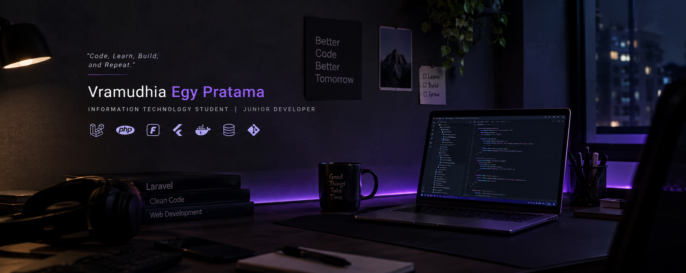

# 👋 Vramudhia Egy Pratama

  

<h3 align="center">🎓 Information Technology Student | 💻 Junior Developer</h3>

  <i>"Code, Learn, Build, and Repeat."</i>

---

## 🧑‍💻 About Me

Hello! I'm **Vramudhia Egy Pratama**, an Information Technology student at Esa Unggul University.

I'm passionate about technology, software development, and building applications that solve real-world problems.

- 🎓 Information Technology Student — Esa Unggul University
- 💻 Interested in Web Development & Software Engineering
- 🚀 Building applications using Laravel and modern technologies
- 🌱 Currently learning Laravel, Filament and Flutter
- 🔍 Always exploring new technologies and improving my skills

---

## 🛠️ Tech Stack

**Backend & Frameworks**

  
  
  
  

**Frontend**

  
  
  
  

**Database & Tools**

  
  
  
  

---

## 🚀 Featured Projects

| Project | Description | Technology |
|---|---|---|
| [Attendify](https://github.com/VeeCaprio/Attendify) | Academic attendance management system | Laravel, Filament |
| [Kriptografi](https://github.com/VeeCaprio/Kriptografi) | AES encryption implementation | Cryptography |

---

## 📊 GitHub Statistics

  
  

  

---

## 🤝 Connect With Me

  

  <i>✨ Keep Learning, Keep Building, Keep Growing.</i>

